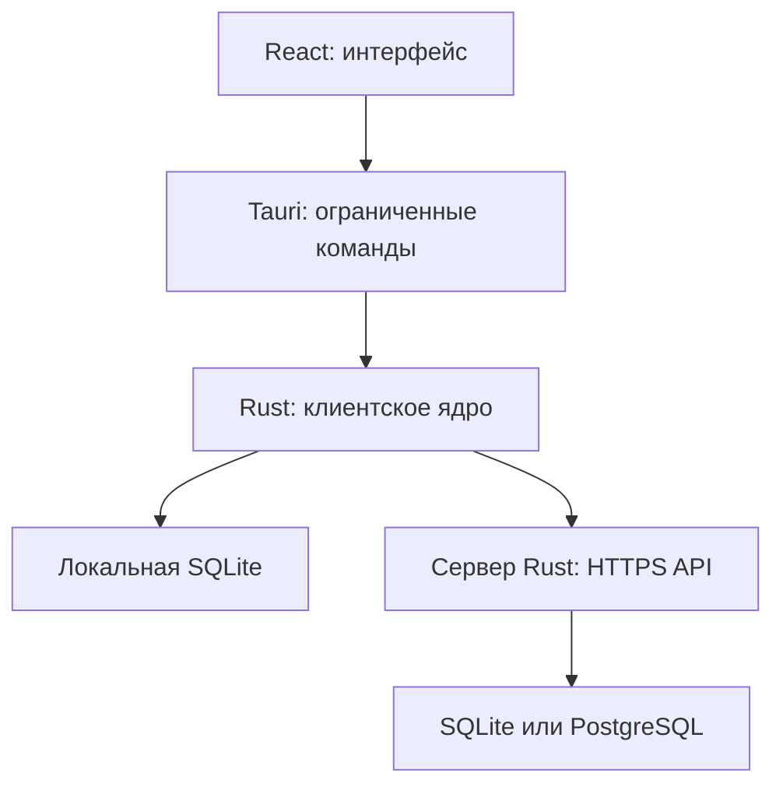

# Neruvalo — спецификация проекта

Версия документа: **0.4**\
Дата: **29 октября 2026 года**\
Статус: **согласованные требования и проект технических решений для прототипа**\
Название продукта: **Neruvalo**. Репозиторий: https://github.com/Urich/neruvalo. Лицензия проекта: **AGPL-3.0-only**.

## 1. Назначение и статус решений

Продукт предназначен для хранения паролей и других секретов, синхронизации собственных устройств и предоставления другим аккаунтам доступа к автоматически обновляемым копиям записей.

Это единый исходный документ для разработки прототипа. Он объединяет принятые пользователем решения и предложенную техническую архитектуру. Документ не является результатом аудита и не подтверждает безопасность будущей реализации.

Обозначения:

- **Требование** — принятое поведение продукта.
- **Проектное решение** — технический способ реализации, подлежащий проверке прототипом.
- **Уточнить** — деталь, которая ещё не согласована; она не должна незаметно становиться требованием.

Основные функциональные решения достаточны для начала прототипа. Оставшиеся уточнения не блокируют проверку регистрации, ключей и личных записей. Прототип использует тестовые данные до завершения необходимых проверок.

## 2. Границы продукта

### 2.1. Платформы

| Платформа | Статус |
|---|---|
| Windows | Первая реализация |
| Linux | Следующий клиент с использованием общего ядра |
| Android | Планируется |
| iPhone / iOS | Планируется |
| Обычная браузерная версия | Отложена; в первый выпуск не входит |
| Расширения браузеров | Позднее, для автозаполнения |

Windows-приложение: **React + TypeScript внутри Tauri**, криптографическое и прикладное ядро — **Rust**. Интерфейс поставляется в установленном пакете. Исполняемые HTML/JS/WASM не загружаются с API-сервера.

Возможность веб-клиента не исключена навсегда. Безопасная доставка и независимая проверка кода потребуют отдельного исследования. Не включать браузерный клиент и WASM-сборку в обязательные задачи первого прототипа.

### 2.2. Сервер и хранение

- Один серверный сервис на Rust.
- Выбор серверной БД при развёртывании: **SQLite или PostgreSQL**.
- Локальное хранилище установленного приложения: **SQLite**.
- Работа с сервером через собственный версионируемый протокол поверх стандартного защищённого транспорта.
- Сквозное шифрование секретного содержимого: сервер не получает мастер-пароль и ключи расшифрования хранилища.
- Общий доступ только между аккаунтами одного сервера.
- Несколько аккаунтов в одном приложении, включая аккаунты на разных серверах.

### 2.3. Что не входит

- Веб-доступ к секретам в первом выпуске.
- Автозаполнение до реализации расширений.
- Файловые вложения.
- Отложенное редактирование офлайн.
- Второй фактор входа в текущем объёме.
- Автоматическая загрузка и установка обновлений ПО.
- Встроенная система резервного копирования и восстановления сервера.
- Балансы криптокошельков, операции с блокчейнами, подписание транзакций.
- Восстановление удалённого аккаунта.

Резервирование выполняется сторонними средствами администрирования. Документация продукта должна описывать состав данных и требования к согласованности копии. Автоматические изменения структуры БД при запуске новой версии не являются автоматическим обновлением ПО.

## 3. Аккаунты и регистрация

### 3.1. Идентичность

Аккаунт идентифицируется парой `server_id + account_id`. Логин уникален в пределах сервера и не меняется. Адрес сервера используется для подключения; идентификатор сервера должен оставаться устойчивым при обычном обслуживании установки.

На одном сервере один email соответствует одному аккаунту. Между независимыми серверами общей уникальности нет.

### 3.2. Регистрация

- Свободная регистрация.
- Защита от ботов и ограничение частоты запросов.
- Обязательное подтверждение email.
- Конкретный поставщик CAPTCHA пока не выбран; подключение не должно давать стороннему скрипту доступ к разблокированному хранилищу.
- Пользователь задаёт мастер-пароль и выбирает наличие или отсутствие восстановления.
- До завершения регистрации сервер хранит только ожидающую регистрацию.
- Сроки жизни ожидающей регистрации и одноразовых токенов задаются серверной политикой.

При нормализации логина и email необходимо заранее зафиксировать правила сравнения. Не применять специфичные для отдельных почтовых провайдеров преобразования вроде удаления точек или суффиксов автоматически.

### 3.3. Изменение email

Требуется подтверждение как старого, так и нового email. Новый адрес не должен принадлежать другому аккаунту на этом сервере. При отсутствии доступа к старому адресу обычная процедура не завершается; обходной сценарий не согласован.

### 3.4. Удаление аккаунта

- Повторный ввод мастер-пароля.
- Подтверждение по email.
- Операция необратима.
- Удаляются собственные записи, архив, история и связанные общие копии.
- Сессии закрываются.
- Удаление аккаунта получателя не затрагивает оригиналы других владельцев.
- Устройства получателей убирают копии после синхронизации.
- Удалённый аккаунт нельзя автоматически восстановить из старой клиентской SQLite.

Удаление из работающего сервера не стирает уже существующие сторонние бэкапы. Их сроки хранения и действия после восстановления БД относятся к администрированию. Синхронизационные маркеры удаления могут временно содержать минимальные идентификаторы без секретного содержимого; срок и способ их очистки — техническая задача.

## 4. Типы записей

Все восемь типов входят в целевую первую версию продукта. Начальный технический прототип может проверять их поэтапно.

| Тип | Специальные поля |
|---|---|
| Логин и пароль | Логин, пароль, URL, TOTP |
| Банковская карта | Номер, держатель, срок действия, платёжная система, банк, CVV/CVC, PIN |
| Заметка | Текст |
| Банковский счёт | Владелец, номер счёта/IBAN, банк, БИК/SWIFT, дополнительные реквизиты |
| API-ключ / токен | Секрет, сервис, адрес, срок действия |
| SSH-ключ | Приватный и публичный ключи, пароль ключа, комментарий |
| Документ | Тип документа, номер, владелец, кем выдан, даты выдачи и окончания |
| Криптокошелёк | Приложение/устройство, сети, публичные адреса, seed-фраза, дополнительная passphrase, приватные ключи, комментарий |

Общие поля:

- Название.
- Папка.
- Теги.
- Заметки.
- Пользовательские поля.

Специальные поля необязательны, если без них запись осмысленна. Например, криптокошелёк может содержать только публичный адрес. Данные SSH-ключей и документов — текстовые поля, не вложения.

Проектная структура:

```json
{
  "type": "bank_card",
  "schema_version": 1,
  "title": "Карта",
  "fields": {
    "number": "...",
    "holder": "...",
    "expires": "...",
    "cvv": "...",
    "pin": "..."
  },
  "notes": "...",
  "custom_fields": []
}
```

Это содержимое шифруется целиком. Окончательные имена полей и форматы дат фиксируются перед реализацией соответствующих типов.

### 4.1. Отображение и проверка

- Секретные значения скрыты по умолчанию.
- Раскрытие и копирование — отдельные действия.
- Номер карты маскируется, обычно видны последние четыре цифры.
- CVV/CVC и PIN поддерживаются как поля типа «Банковская карта».
- Seed-фразы, passphrase и приватные ключи — секретные поля.
- Номер карты при копировании может нормализоваться без пробелов; PIN и другие секреты хранятся строками, с сохранением ведущих нулей.
- Проверки формата предупреждают об ошибке, но не должны уничтожать введённые данные.
- Секретные поля не включаются в уведомления, журналы и сообщения об ошибках.
- Исторические значения остаются в истории до удаления аккаунта владельца.
- Криптокошелёк — только хранение. Предоставление seed-фразы или приватного ключа даёт получателю возможность управлять соответствующими средствами; интерфейс явно предупреждает об этом перед передачей всей записи.

## 5. Владение и история

У каждого оригинала один владелец. Только владелец:

- Меняет содержимое.
- Видит историю.
- Восстанавливает историческую версию.
- Архивирует и восстанавливает оригинал.
- Предоставляет и отзывает доступ.

Изменение возможно с любого устройства владельца, но только онлайн. Другой аккаунт не редактирует оригинал или полученную копию.

Каждое сохранение создаёт неизменяемую версию. Отдельные версии нельзя удалить. Восстановление старой версии создаёт новую текущую версию с прежним содержимым, сохраняя все промежуточные версии.

История, включая архив, хранится до явного удаления аккаунта владельца. Владелец получает всю историю в локальную SQLite для офлайн-просмотра.

## 6. Совместный доступ

### 6.1. Предоставление

- Только владелец.
- Выбор получателя по логину или QR-коду.
- Только аккаунт того же сервера.
- Согласие получателя не требуется.
- Создаётся самостоятельная копия с собственным идентификатором и ссылкой на оригинал.
- Передаётся вся запись, без выбора отдельных секретных полей.
- При изменении оригинала активная копия обновляется.
- Получатель видит только текущее содержимое, без истории.
- Получатель не может редактировать содержимое и передавать доступ от имени владельца.
- Появляется уведомление о новой записи. Каналы уведомления настраиваются пользователем.

«Самостоятельная копия» означает отдельную сущность получателя; она не является свободно редактируемым клоном.

### 6.2. Прекращение и повторная выдача доступа

| Действие | Последствие |
|---|---|
| Получатель удаляет копию | Доступ прекращается только для него |
| Владелец отзывает доступ | Доступ прекращается у выбранного получателя |
| Владелец архивирует оригинал | Прекращаются все доступы |
| Владелец восстанавливает оригинал | Старые доступы не восстанавливаются |
| Повторная выдача | Новый доступ и новая копия |
| Удаление владельца | Удаление оригинала и всех связанных копий |

После синхронизации клиент удаляет доступное содержимое отозванной копии и ключи. На сервере остаются необходимые служебные события прекращения доступа, но получатель не получает историю.

Офлайн-устройство узнает об отзыве при подключении. Бессрочное офлайн-чтение не позволяет гарантировать мгновенный отзыв. Программа не может отменить знание уже прочитанного или скопированного секрета.

### 6.3. QR и проверка ключа

QR содержит:

- Версию формата.
- Адрес и идентификатор сервера.
- Идентификатор аккаунта.
- Отпечаток публичных ключей.

Секретов в QR нет. QR не является разрешением на чтение.

При поиске по логину сервер предоставляет публичный ключ. Проектная защита: запоминание первого увиденного ключа и предупреждение о его смене; проверка отпечатка по независимому каналу при необходимости. Это не устраняет подмену при самом первом обращении к скомпрометированному каталогу.

### 6.4. Несогласованная деталь

Предложено разрешить получателю собственные папки и теги для копии без изменения её содержимого. Папки и теги владельца при этом не раскрываются автоматически. Это предложение ещё не подтверждено; до согласования не реализовывать как окончательное правило. Для прототипа допустим отдельный раздел «Полученные».

## 7. Онлайн и офлайн

### 7.1. Онлайн

Доступны создание, изменение, архивирование, восстановление, импорт, настройки сервера и операции доступа.

### 7.2. Офлайн

- Только чтение ранее синхронизированной SQLite.
- Срок чтения не ограничен.
- Доступна вся собственная история.
- Общие копии содержат только текущую синхронизированную версию.
- Нет очереди изменений и последующей автоматической отправки.
- Показываются отсутствие связи и время последней синхронизации.

Операции, создающие данные на сервере, блокируются. Состояние прочтения уведомлений и иные локальные UI-данные не должны превращаться в скрытую очередь пользовательского редактирования.

### 7.3. Конфликт устройств

Форма запоминает ревизию оригинала. Сервер сравнивает её с текущей в транзакции.

При несовпадении:

- Данные на сервере не изменяются.
- Повторное сохранение блокируется до синхронизации.
- Показывается точный текст:

> Запись изменена на другом устройстве. Синхронизируйте устройства.

Не выполнять автоматическое слияние и не подставлять новую ожидаемую ревизию для слепого повтора. Введённое значение можно временно держать в памяти формы для сравнения; при блокировке приложения оно очищается.

### 7.4. Неизвестный результат

Если связь оборвалась после отправки, сервер мог завершить транзакцию. Клиент выясняет результат по `operation_id`. Пока результат не установлен, показывает соответствующее состояние и не выдаёт догадку за успешное или неуспешное сохранение.

## 8. Сессии и локальная блокировка

### 8.1. Независимые состояния

Для каждого аккаунта независимо учитываются:

| Состояние | Значения |
|---|---|
| Соединение | Онлайн / офлайн |
| Локальное хранилище | Заблокировано / разблокировано |
| Серверная сессия | Активна / истекла / отозвана |

Истечение серверной сессии само по себе не уничтожает офлайн-доступ к ранее выданным данным.

### 8.2. Настройки

- Тайм-аут аккаунта хранится на сервере и синхронизируется.
- Значение по умолчанию: **одна минута**.
- «Никогда» разрешено.
- Отсчёт отдельно на каждом аккаунте и устройстве.
- Активность другого устройства не продлевает таймер.
- Офлайн применяется последнее синхронизированное значение.
- Фоновые запросы и WebSocket не считаются активностью пользователя.
- При сворачивании учитывается установленный тайм-аут.
- Блокировка Windows и переход в сон блокируют все аккаунты независимо от «никогда».
- После перезапуска для каждого аккаунта требуется мастер-пароль.
- Повторная разблокировка в текущем запуске: мастер-пароль или Windows Hello, по выбору пользователя.
- PIN приложения не входит в принятый набор способов.

Не путать этот тайм-аут с серверным сроком жизни токена; последний является технической политикой и должен быть описан отдельно. Семантику активности нескольких окон одного аккаунта следует зафиксировать при проектировании UI.

### 8.3. Буфер обмена

По умолчанию очистка через 30 секунд. Пользователь может изменить срок или отключить очистку. Очищать только собственное скопированное значение, не затрагивая новое содержимое буфера.

Отключение тайм-аута или очистки — явная настройка, без скрытого изменения поведения.

## 9. Архитектура приложения и сервера



### 9.1. Workspace

| Модуль | Назначение |
|---|---|
| `protocol` | Типы сообщений, версии, идентификаторы, ошибки |
| `crypto` | Ключи, контейнеры, шифрование, подписи |
| `client-core` | Операции аккаунта и пользовательские сценарии |
| `client-storage` | Зашифрованные данные в SQLite |
| `client-sync` | Транспорт и синхронизация |
| `import-export` | Наш архив и адаптеры KeePass/Bitwarden |
| `desktop` | Tauri, Windows Hello, события ОС, буфер |
| `server` | Аутентификация, регистрация, права, API |
| `server-storage` | Реализации SQLite/PostgreSQL и миграции |
| `ui` | React/TypeScript |

Криптография не зависит от React, Tauri или БД. Общая модель не содержит прямых вызовов Windows. Для будущих Kotlin/Swift возможен UniFFI; это направление, а не обязательная зависимость первого прототипа.

### 9.2. Серверные модули

Accounts, Authentication, Recovery, Sessions, Devices, Records, Sharing, Sync, Notifications, Settings, Storage.

Сервер проверяет владельца и права на каждую операцию. Наличие идентификатора записи или валидного контейнера не даёт разрешения на запись.

### 9.3. Изоляция аккаунтов

Проектное решение: отдельная SQLite на пару сервер/аккаунт, отдельные сессия, ключевой контекст и таймер. Нельзя случайно отправить данные одного аккаунта серверу другого. Смена активного аккаунта не должна смешивать формы, буферные операции или расшифрованные результаты.

## 10. Криптографическая схема

### 10.1. Примитивы

| Назначение | Проектный выбор |
|---|---|
| Вход | OPAQUE |
| Усиление пароля | Argon2id |
| Шифрование содержимого и оболочек | XChaCha20-Poly1305 |
| Передача ключа получателю | Готовый sealed box на X25519 |
| Подпись владельца | Ed25519 |
| Выведение ключей | HKDF-SHA-256 с разными контекстами |
| Случайные значения | Системный CSPRNG |

Для XChaCha20-Poly1305: ключ 32 байта, nonce 24 байта, тег 16 байт. Для новых операций шифрования nonce генерируется заново. Точный набор ciphersuite, параметры OPAQUE/Argon2id, форматы sealed box и правила кодирования подписей фиксируются по результатам прототипа до выпуска с реальными данными.

Пользователь не выбирает алгоритм. Контейнеры включают версии и идентификаторы схем, чтобы поддержать будущую эволюцию. Никогда не выполнять молчаливое понижение криптографической схемы.

### 10.2. Ключи аккаунта

Клиент генерирует случайный `K_account` размером 32 байта. Он защищает контейнер:

- `K_owner` — защита ключей собственных версий.
- `SK_sign` — подпись операций и копий.
- `SK_share` — открытие ключей полученных копий.

Публичные `PK_sign` и `PK_share` доступны серверу. Отдельный постоянный ключ `SK_auth` для обычного входа не нужен: используется OPAQUE.

### 10.3. Оболочки K_account

| Оболочка | Где | Ключ открытия |
|---|---|---|
| Серверная | Сервер | Из OPAQUE export_key через HKDF |
| Локальная | SQLite устройства | Из мастер-пароля через Argon2id |
| Восстановления | Сервер, при включении | Из секрета мастер-сертификата |

Не хранить на сервере дополнительную оболочку, напрямую открываемую обычным Argon2id от пароля: это создаст отдельную проверку догадок вне выбранной схемы OPAQUE.

Локальная оболочка нужна для офлайн-входа. Её кража позволяет офлайн-перебор мастер-пароля; Argon2id увеличивает стоимость, но не заменяет сильный пароль.

Ключ OPAQUE-сессии, export_key и прикладные ключи имеют разное назначение. Использовать разные контексты HKDF и не переиспользовать один ключ для разных примитивов.

### 10.4. Общий контейнер

```json
{
  "format_version": 1,
  "suite": "xchacha20poly1305-v1",
  "nonce": "base64url",
  "ciphertext": "base64url"
}
```

Ciphertext включает тег. AAD связывает идентификатор сервера, аккаунт, тип контейнера, версии формата и криптографии, объект и версию объекта. Контекст проверяется, а не принимается безусловно из недоверенного контейнера.

AAD и подписываемые данные кодируются по однозначной спецификации: порядок, типы, длины, обработка строк. Обычный произвольный JSON не считается каноническим.

### 10.5. История оригинала

Каждая версия имеет случайный `version_id` и новый случайный `K_version`:

1. Содержимое шифруется `K_version`.
2. `K_version` защищается ключом владельца.
3. В контекст включаются запись, владелец, версия и предшествующая версия.
4. Подпись связывает служебную структуру и шифротекст.

При обычной смене пароля ключи записей не меняются. При компрометации ключевого материала потребуется отдельная процедура ротации, не равная смене пароля.

### 10.6. Общие копии

Для каждого получателя и каждого обновления:

1. Создать новое зашифрованное содержимое копии с новым случайным ключом.
2. Упаковать ключ для публичного ключа получателя через sealed box.
3. Подписать оригинал, его версию, получателя, copy_id, share_id и контейнеры.
4. Отправить вместе с оригиналом одной операцией.

Sealed box сам по себе не подтверждает владельца: подпись обязательна. Точный внутренний шифр sealed box зависит от выбранной готовой реализации и не обязан совпадать с шифром содержимого.

Получатель не получает `K_owner`, ключи истории или контейнеры оригинала. Он может технически сохранять ранее выданные ему версии; запрет истории означает отсутствие выдачи истории продуктом, а не невозможность самостоятельного копирования.

Сервер может проверить подписи, права и полноту списка получателей, но без расшифровки не может доказать равенство содержимого оригинала и всех копий. Корректный клиент обеспечивает это; не заявлять серверную гарантию проверки открытых значений.

## 11. Вход, восстановление и локальная разблокировка

### 11.1. Регистрация ключей

После подтверждения email выполняются OPAQUE-регистрация, генерация ключей аккаунта, серверной оболочки и опционального восстановления. Финализация аккаунта атомарна.

Включённое восстановление сопровождается сохранением файла и проверкой его повторного чтения. Секрет файла не отправляется серверу.

### 11.2. Онлайн-вход

- Начать обмен OPAQUE с логином.
- Завершить взаимную проверку согласно выбранной библиотеке.
- Сервер создаёт сессию только после успешной финализации.
- Клиент открывает оболочку через ключ из export_key.
- Проверяет контейнер аккаунта, выполняет синхронизацию.
- На новом устройстве создаёт локальную оболочку.

OPAQUE не делает слабые пароли неуязвимыми и не исключает перебор при полной компрометации серверных секретов. Серверный OPAQUE setup должен сохраняться администраторами вместе с остальными критическими данными; его потеря не является обычной сменой конфигурации.

### 11.3. Офлайн-вход и смена пароля

Локальная Argon2id-оболочка открывается мастер-паролем. Если пароль изменён на другом устройстве, прежняя отключённая копия продолжает открываться старым паролем до обновления локального состояния. Это принятое следствие бессрочного офлайн-доступа.

После онлайн-входа с новым паролем локальная оболочка обновляется. Полный сброс удалённых устройств невозможен без их подключения.

### 11.4. Windows Hello

Требование: не заменяет первый мастер-пароль после запуска приложения.

Проект: временная защита материала разблокировки системным механизмом плюс секрет текущего запуска, не сохраняемый на диск. После завершения процесса этого секрета нет. Простого булевого ответа диалога Hello недостаточно: проверка должна быть связана с получением защищённого материала. Реализацию, наличие TPM и границы системных гарантий проверять отдельным прототипом; не обещать аппаратную защиту на любом компьютере.

### 11.5. Мастер-сертификат

Незашифрованный файл содержит случайный секрет восстановления, recovery_id, server_id, account_id, адрес сервера и версию формата. Из секрета раздельно выводятся ключ оболочки и ключ подтверждения восстановления.

Сервер хранит публичный ключ подтверждения и оболочку, но не секрет. Любой обладатель файла может восстановить доступ. При отключённом восстановлении email не позволяет открыть данные.

Можно включать, отключать и заменять восстановление после подтверждения мастер-пароля. Замена сразу отзывает старый recovery_id. Старый файл не должен приниматься сервером, но его обладатель мог ранее сохранить секреты.

### 11.6. Процедура восстановления

1. Выбор файла, проверка сервера и аккаунта.
2. Получение одноразового challenge и действующей оболочки.
3. Локальная расшифровка и подпись подтверждения.
4. Ввод нового мастер-пароля и новый OPAQUE registration flow.
5. Атомарная замена входа и серверной оболочки с проверкой ревизий.
6. Увеличение session_epoch и закрытие всех сессий.
7. Обновление локальной оболочки текущего устройства.

### 11.7. Смена мастер-пароля

Повторная проверка текущего пароля, новая OPAQUE-регистрация, новая серверная оболочка того же K_account, атомарная замена и закрытие остальных сессий. История и совместные связи сохраняются. Смена пароля не устраняет последствия утечки старого K_account.

## 12. Модель серверных данных

| Сущность | Содержание |
|---|---|
| Account | ID, логин, email, статус |
| PendingRegistration | Подтверждение регистрации, срок |
| EmailChange | Старый/новый адрес, независимые подтверждения |
| AccountAuth | OPAQUE registration record, профиль, auth_revision |
| AccountKeys | Публичные ключи, оболочка K_account, контейнер, key_bundle_revision |
| Recovery | recovery_id, публичное подтверждение, оболочка, recovery_revision |
| Device | Аккаунт, ID, имя/платформа, служебные времена |
| Session | Аккаунт, устройство, срок, session_epoch, защищённое представление токена |
| Settings | Тайм-аут, уведомления, ревизия |
| Record | Владелец, текущая ревизия, архив, sharing_revision |
| RecordVersion | version_id, предшественник, контейнер, оболочка, подпись |
| Share | Оригинал, получатель, статус доступа |
| SharedCopy | share_id, copy_id, текущая версия, контейнер и ключ получателя |
| Folder / Tag | Зашифрованное название и служебные связи |
| Notification | Тип, связанный ID, состояние прочтения |
| ChangeEvent | Последовательность изменений для аккаунта |
| OperationResult | Идемпотентность и результат |
| SchemaVersion | Применённые миграции структуры |

Обязательны внешние ключи, ограничения уникальности и транзакции. Авторизация не должна зависеть только от фильтра в интерфейсе.

Служебные метаданные доступны серверу: аккаунты, связи доступа, времена, размеры, версии. Названия, секретные поля, заметки и названия папок/тегов шифруются. При необходимости сокрытия структуры связей потребуется отдельное расширение модели угроз.

### 12.1. Локальная SQLite

Отдельная БД на аккаунт содержит:

- Привязку к серверу и аккаунту.
- Зашифрованные контейнеры ключей и локальную оболочку.
- Собственные записи и всю историю.
- Текущие полученные копии.
- Зашифрованные папки, теги и связи.
- Последние настройки.
- Курсор синхронизации и ревизии.
- Результат/идентификатор незавершённого серверного запроса, если требуется выяснить исход.

Открытые секреты, пароль и постоянный открытый поисковый индекс на диск не записываются. Поиск по секретному содержимому выполняется после разблокировки в памяти. Дополнительное шифрование всей SQLite не заменяет шифрование контейнеров.

## 13. Минимальный протокол

### 13.1. Транспорт

- HTTPS API, проектный префикс `/api/v1`.
- JSON для сообщений, Base64url для бинарных полей.
- WebSocket для сигналов, не единственный источник синхронизации.
- TLS обязателен.
- Стандартные библиотеки криптографии; собственные алгоритмы и собственный TLS не разрабатываются.
- Ограничения размеров, количества записей в пакетах и времени запросов.
- Для Tauri используются подходящие клиентские токены; ранее предложенные браузерные cookies не являются обязательным механизмом нативного клиента.
- Токен сессии не заменяет доступ к ключам хранилища.

### 13.2. Начальное согласование

`server.info` возвращает server_id, поддерживаемые версии протокола, возможности, ограничения, версии crypto suite и профили входа. Клиент проверяет сохранённую идентичность сервера.

Неизвестные обязательные возможности приводят к понятному отказу, а не попытке угадать формат. Профили KDF проверяются по локальным нижним и верхним границам, чтобы сервер не навязал чрезмерное потребление памяти или ослабление защиты.

### 13.3. Операции

| Группа | Операции |
|---|---|
| Регистрация | registration.start, registration.verify_email, registration.finish |
| Вход | auth.begin, auth.finish, session.close |
| Устройства | devices.list, sessions.list, sessions.revoke |
| Восстановление | recovery.enable, recovery.replace, recovery.disable, recovery.begin, recovery.finish |
| Пароль | password.change.begin, password.change.finish |
| Аккаунт | email.change.*, account.delete.begin, account.delete.finish |
| Настройки | settings.get, settings.update |
| Получатель | users.resolve |
| Записи | records.create, records.get, records.update, records.history |
| Архив | records.archive, records.unarchive, records.restore_version |
| Доступ | shares.create, shares.revoke, shares.dismiss |
| Организация | folders.*, tags.* |
| Синхронизация | sync.snapshot, sync.pull |
| Результат запроса | operations.get |
| Уведомления | notifications.list, notifications.mark_read |
| Пакетный импорт | import.begin, import.upload, import.commit, import.abort |

Конкретные URL, байтовые форматы OPAQUE и подписей — задача следующей детализации. Приведённые имена задают семантику, а не готовый OpenAPI-контракт.

### 13.4. Пример обновления

```json
{
  "protocol_version": 1,
  "operation_id": "uuid",
  "type": "records.update",
  "record_id": "uuid",
  "expected_record_revision": 5,
  "expected_sharing_revision": 2,
  "new_version": {
    "version_id": "uuid",
    "ciphertext": "...",
    "owner_key_envelope": "..."
  },
  "shared_copy_updates": [
    {
      "share_id": "uuid",
      "copy_id": "uuid",
      "ciphertext": "...",
      "recipient_key_envelope": "...",
      "signature": "..."
    }
  ],
  "signature": "..."
}
```

Это логический сокращённый пример: обязательные nonce, форматы конвертов и подписываемый контекст определяются crypto-спецификацией.

Сервер одной транзакцией проверяет:

1. Активность аккаунта и сессии.
2. Владение оригиналом.
3. Подписи и версии форматов.
4. Совпадение record_revision.
5. Совпадение sharing_revision и полный актуальный набор активных получателей.
6. Отсутствие архивации.
7. Идемпотентность операции.

Затем добавляет историю, меняет текущую версию, обновляет копии и создаёт события всем затронутым аккаунтам. Частичное сохранение не допускается.

### 13.5. Идемпотентность

`operation_id` уникален в контексте аккаунта. Одинаковая операция возвращает прежний результат. Тот же ID с другим содержимым отклоняется. Проверка прав и область доступа к результатам обязательны.

Срок хранения результатов и поведение после его истечения фиксируются до выпуска. Клиент не должен бесконечно повторять сомнительную операцию после удаления серверного результата; при необходимости выясняет состояние объекта.

### 13.6. Ошибки

| Код | Смысл |
|---|---|
| AUTH_FAILED | Не удалось подтвердить вход |
| SESSION_EXPIRED / SESSION_REVOKED | Требуется вход |
| EMAIL_NOT_VERIFIED | Регистрация не завершена |
| ACCESS_DENIED | Нет прав |
| RECORD_VERSION_MISMATCH | Оригинал изменён |
| SHARING_VERSION_MISMATCH | Изменился набор получателей |
| RECORD_ARCHIVED | Нельзя изменить активное содержимое |
| RECIPIENT_NOT_FOUND | Получатель не найден |
| CROSS_SERVER_SHARE_UNSUPPORTED | Другой сервер |
| RECOVERY_REVOKED | Сертификат больше не действителен |
| OPERATION_ID_REUSED | ID использован с другим запросом |
| UNSUPPORTED_PROTOCOL / FORMAT | Несовместимый протокол/данные |
| VALIDATION_FAILED | Некорректный запрос |
| RATE_LIMITED | Ограничение частоты |

Ошибки не содержат секретные значения. Конкретную выдачу AUTH_FAILED/EMAIL_NOT_VERIFIED согласовать с защитой от перечисления аккаунтов. Публичный поиск логинов для обмена означает, что полную скрытность существования аккаунтов не обещаем.

## 14. Синхронизация

### 14.1. Принцип

Сервер — источник актуального состояния; локальная SQLite — зашифрованная читаемая офлайн-копия. Клиент хранит курсор подтверждённого пакета изменений.

1. Проверить протокол и сессию.
2. При первом входе получить согласованный snapshot.
3. Получать изменения по курсору.
4. Проверять форматы и подписи.
5. Применять пакет с новым курсором одной SQLite-транзакцией.
6. Получать WebSocket-сигналы о наличии следующего пакета.

Снимок и курсор должны соответствовать одной согласованной границе состояния. При слишком старом курсоре используется полная пересинхронизация с удалением отсутствующих копий; хранить журнал бесконечно не требуется.

### 14.2. События

record.changed, record.archived, share.created, share.updated, share.removed, settings.changed, notification.created, session.revoked.

Сигнал содержит минимальные идентификаторы, не содержимое секретов. Получение сигнала не подтверждает применение изменения; подтверждается только транзакционно сохранённый курсор.

При запуске онлайн сначала применяются изменения доступа и удалений, затем показываются полученные записи. При отсутствии сервера разрешено последнее локальное состояние.

### 14.3. Гонки доступа

Операции предоставления, отзыва, отказа и архивирования меняют sharing_revision. Обновление со старым набором получателей отклоняется. Удаление аккаунта или архивирование не должно соревноваться с сохранением так, чтобы отозванная копия появилась снова.

### 14.4. Уведомления

Каналы настраиваются пользователем: предполагаются приложение и email. Точные значения по умолчанию не выбраны. Email не содержит сам секрет, содержимое карточки или её чувствительное название. Уведомления синхронизируются между устройствами; детали отметки прочтения уточняются.

## 15. Импорт, экспорт и перенос

### 15.1. Источники

- KeePass: KDBX; поддерживаемые версии и способы открытия проверяются выбранным адаптером.
- Bitwarden: поддерживаемые варианты экспорта фиксируются явно; JSON/зашифрованные варианты зависят от реализации.
- Наш зашифрованный формат.
- CSV как общий самостоятельный формат не утверждён.

Отсутствующие у источника типы отображаются по явной таблице соответствия. Неподдерживаемые поля отражаются в отчёте, не теряются молча. Вложения не поддерживаются; импорт не должен делать вид, что они перенесены.

### 15.2. Поведение импорта

- Импорт только онлайн.
- До начала пользователь задаёт название новой подпапки.
- Весь файл импортируется внутрь неё с сохранением внутренней структуры.
- Существующие записи не перезаписываются и не объединяются автоматически.
- Идентификаторы создаются заново.
- Наш формат сохраняет историю собственных записей.
- Доступы старого сервера автоматически не переносятся.
- Отсутствующая история в стороннем формате не выдумывается.
- Конфликты типов, теги, архив и потерянные ссылки отображаются в предварительном отчёте.

Проект: пакетная загрузка во временную область и атомарная публикация результата. Поддержка объёма/лимитов и очистка незавершённых импортов — серверная реализация. Весь импорт не обязан помещаться в память.

### 15.3. Наш экспорт

- Только зашифрованный формат.
- Отдельный пароль файла.
- Все собственные записи, архив, история и организация данных.
- Полученные копии исключаются.
- Ключи входа, сессии, recovery_secret и личные ключи аккаунта не экспортируются как способ переноса идентичности.
- Для импорта генерируются новые ключи и идентификаторы; секреты перешифровываются для целевого аккаунта.
- Файл имеет собственные версии, KDF-параметры и аутентифицируемый манифест.

Политика отдельных записей против полного экспорта и точная структура архива уточняются при реализации. Базовый сценарий — полный экспорт собственных данных.

### 15.4. Два разных переноса

1. **Пользовательский импорт в аккаунт:** новые идентификаторы и папка, без старых доступов.
2. **Перенос серверной БД SQLite ↔ PostgreSQL:** требуется отдельная административная спецификация экспорта/импорта с сохранением идентичности аккаунтов, OPAQUE setup, контейнеров и связей.

Не считать пользовательский архив достаточным для переноса всей серверной установки. Встроенных бэкапов нет. Серверный перенос через экспорт/импорт принят; его административный формат пока не определён и не блокирует прототип.

## 16. Версионность и миграции

Раздельно учитываются:

- Версия ПО.
- Основная версия протокола.
- Версия серверной схемы БД.
- Версия локальной схемы SQLite.
- Формат контейнера/crypto suite.
- Версия схемы конкретного типа записи.
- Версия нашего экспортного формата.

Обновление ПО выполняет пользователь. Новая программа автоматически применяет поддерживаемые миграции структуры, транзакционно там, где это возможно. Конкурирующие процессы миграции исключаются.

Старое ПО не изменяет неизвестную более новую БД. Перед запуском проверяет диапазон поддержки и выдаёт понятную ошибку. Автоматический downgrade не предусмотрен.

Обратная совместимость:

- Старый поддерживаемый клиент работает с новым сервером.
- Новый клиент со старым сервером использует согласованное подмножество.
- Новые необязательные поля не меняют смысл старых.
- Неизвестные обязательные возможности приводят к отказу.
- Старый клиент сохраняет неизвестные поля либо блокирует редактирование; не теряет их при повторном сохранении.
- Неизвестный тип хранится как непрозрачные зашифрованные данные и отображается как неподдерживаемый без редактирования.
- Новая несовместимая основная версия имеет отдельную точку протокола.
- Разрешённая продолжительность поддержки старых версий и политика критически уязвимых клиентов ещё не определены.

## 17. Технологии и библиотеки

Это выбранные направления; точные стабильные версии закрепляются lock-файлами после проверки совместимости.

| Область | Выбор |
|---|---|
| Ядро / сервер | Rust |
| Windows | Tauri |
| UI | React, TypeScript, Vite |
| Вход | opaque-ke |
| KDF | argon2, hkdf, sha2 |
| AEAD | chacha20poly1305::XChaCha20Poly1305 |
| Sealed box | crypto_box с поддержкой seal |
| Подписи | ed25519-dalek |
| Случайность | getrandom и совместимый rand_core |
| Очистка буферов | zeroize |
| Форматы | serde, serde_json, base64, uuid |
| Асинхронность | tokio |
| HTTP / WebSocket | axum |
| Middleware | tower, tower-http |
| БД | sqlx |
| Почта | lettre |
| Логи | tracing, tracing-subscriber |
| Reverse proxy | Caddy или инфраструктурный эквивалент |
| UI-проверки | Vitest, Playwright |

Ранее предложенный tower-sessions относится к возможному cookie-механизму; для нативного прототипа окончательный session adapter выбирается при реализации. WASM, wasm-bindgen и wasm-pack не нужны первому выпуску без браузера. Схему входа OPAQUE не переписывать самостоятельно.

Проверить готовый поддерживаемый Rust-адаптер KDBX, лицензию, тестовые файлы и корректность импорта перед добавлением в зависимости.

## 18. Границы безопасности и защиты

### 18.1. От чего защищаемся

Кража серверной БД, перехват сети, подмена контейнеров, повтор запросов, неавторизованный доступ другого аккаунта, случайная перезапись при гонках, потеря устройства в заблокированном состоянии, утечки через логи и UI.

### 18.2. Что не обещаем

- Защиту открытых секретов от полностью скомпрометированной ОС.
- Удаление уже увиденных секретов у получателя.
- Мгновенный отзыв на отключённом устройстве.
- Скрытие всех серверных метаданных.
- Полное гарантированное стирание следов SQLite/SSD.
- Полное обнаружение отката всей установки без независимого доверенного состояния.
- Защиту от подмены ключа при первом поиске по логину без внешней проверки.
- Безопасность слабого мастер-пароля.

### 18.3. Прикладные меры

- Ограниченный API между React и Rust; нет произвольного SQL, shell или доступа к файлам из UI.
- Запрет загрузки удалённого исполняемого кода.
- CSP и безопасный вывод строк, включая импорт и общие записи.
- Секреты не попадают в telemetry, stdout, crash reports и debug-логи.
- Открытые данные не сохраняются в WebView localStorage/IndexedDB.
- Контролируемая очистка Rust-буферов; минимум копий строк в UI.
- При блокировке очищаются формы и расшифрованное состояние.
- Ограничения размера/сложности контейнеров, KDF и импортов.
- Ограничение частоты входа, регистрации, email и восстановления.
- Одноразовые подтверждения с TTL, назначением, привязкой к аккаунту и ревизии.
- HTTPS и проверка сертификатов.
- Проверка вложенных URL до запуска внешнего обработчика.
- Нет отправки секретных названий в email.
- Сборки выполняются с зафиксированными зависимостями.

Обновления устанавливает пользователь. Это не исключает необходимости контроля происхождения сборки; конкретная схема подписания выпусков — отдельная техническая задача, без автоматического обновляющего сервиса.

## 19. Прототип и этапы

### Этап A. Криптографический прототип

Тестовые данные, без полного UI:

1. Регистрация/вход OPAQUE.
2. Получение export_key и открытие K_account.
3. Локальная оболочка и офлайн-открытие.
4. Смена пароля без потери тестовой истории.
5. Создание, замена, отключение мастер-сертификата.
6. Восстановление и отзыв сессий.
7. Обработка неправильного пароля, повреждения, неподдерживаемой схемы.

### Этап B. Вертикальный срез Windows

- Tauri + React.
- Сервер и SQLite.
- Аккаунт, регистрация и email.
- Создание/чтение/редактирование одного типа.
- История, архив и восстановление.
- Перезапуск, блокировка, офлайн-чтение.
- Обе серверные БД проверяются до признания слоя хранения завершённым.

### Этап C. Все типы и организация

Восемь типов, папки, теги, пользовательские поля, секретное отображение, буфер обмена, TOTP и поиск.

### Этап D. Несколько устройств и аккаунтов

Изоляция аккаунтов, два сервера, конфликты версий, snapshot/delta, восстановление после разрыва.

### Этап E. Совместный доступ

Логин/QR, текущие копии, атомарные обновления, отзыв/отказ, архивирование, уведомления.

### Этап F. Перенос и интеграция

Наш экспорт/импорт, KeePass/Bitwarden, Windows Hello, обновление структуры БД, проверки совместимости и упаковка.

Этапы — порядок реализации, а не сокращение согласованного конечного объёма.

## 20. Критерии проверки

| Сценарий | Ожидаемый результат |
|---|---|
| Верный пароль | Ключи открываются, вход успешен |
| Неверный пароль | Нет сессии и открытых данных |
| Изменён ciphertext/AAD | Проверка не проходит |
| Подмена объекта/получателя | Проверка контекста/подписи не проходит |
| Старый мастер-сертификат | Сервер не разрешает восстановление |
| Восстановление | Новые данные входа, старые сессии закрыты |
| Два сохранения с одной ревизии | Одно успешно, другое — установленный конфликт |
| Отказ получателя во время сохранения | Отозванный доступ не возрождается |
| Обрыв после commit | Повтор operation_id возвращает прежний результат |
| Повтор ID с иным содержимым | Отказ |
| Получатель запрашивает историю | ACCESS_DENIED |
| Архив и восстановление | Старые доступы остаются закрыты |
| Офлайн | Только чтение, без очереди изменений |
| Сон / блокировка Windows | Все аккаунты заблокированы |
| Перезапуск | Hello не обходит первоначальный мастер-пароль |
| Два аккаунта | Ключи и данные не смешиваются |
| SQLite / PostgreSQL | Одинаковые прикладные результаты |
| Новый неизвестный тип | Нет потери полей и опасного редактирования |
| Импорт | Новая папка, без перезаписи существующих |
| Экспорт | История собственных записей есть, полученных копий нет |
| Буфер изменён другой программой | Его новое содержимое не очищается |
| Удаление аккаунта | Данные и связи удалены, сессии отозваны |

Проверки криптографии включают известные тестовые векторы и межплатформенные round-trip; проверки API — негативные права и гонки транзакций; импорт — повреждённые и чрезмерно большие файлы. Проверка в тестах не заменяет независимый аудит.

## 21. Оставшиеся уточнения

Не блокируют этап A, но должны быть решены до выпуска затрагиваемой функции:

1. Правила применения бренда Neruvalo и оформление продукта.
2. Папки/теги получателя для общей копии и правила их офлайн-изменения.
3. Каналы и значения по умолчанию для уведомлений, включая настройку очистки буфера на сервере или только устройстве.
4. Точная семантика пользовательской активности при нескольких окнах.
5. Стабильные версии библиотек, профиль OPAQUE и Argon2id, однозначное кодирование подписи/AAD.
6. Сроки сессий и результатов операций, лимиты импорта, полный resync.
7. Конкретный механизм CAPTCHA и способ прохождения проверки из установленного приложения.
8. Поддерживаемые KDBX-версии, способы открытия и варианты экспортов Bitwarden.
9. Формат административного переноса всего сервера между SQLite и PostgreSQL.
10. Политика поддержки старых протоколов и отзыва критически уязвимых клиентов.
11. Допустимые форматы секретных полей и проверок восьми типов записей.
12. Поведение офлайн-экспорта: требование «офлайн только чтение» не определило явно разрешение создания файла экспорта. До уточнения экспорт доступен онлайн.

Не выдавать эти пункты за уже согласованные требования.

## 22. Источники технических решений

Ссылки для разработчика; требования продукта определены обсуждением, а не этими источниками. Версии и рекомендации необходимо сверять при закреплении зависимостей.

- OPAQUE, RFC 9807: https://www.rfc-editor.org/rfc/rfc9807.html
- opaque-ke: https://github.com/facebook/opaque-ke
- API и export_key: https://docs.rs/opaque-ke/latest/opaque_ke/
- Argon2, RFC 9106: https://www.rfc-editor.org/rfc/rfc9106.html
- AEAD/XChaCha20-Poly1305: https://docs.rs/chacha20poly1305/latest/chacha20poly1305/
- Sealed box / crypto_box: https://docs.rs/crypto_box/latest/crypto_box/
- Ed25519: https://docs.rs/ed25519-dalek/latest/ed25519_dalek/
- Axum: https://docs.rs/axum/latest/axum/
- SQLx: https://docs.rs/sqlx/latest/sqlx/
- Tauri: https://v2.tauri.app/
- UniFFI: https://mozilla.github.io/uniffi-rs/latest/

## 23. Ближайший результат разработки

Первый проверяемый результат — прототип без реальных секретов:

**регистрация → вход → создание контейнера → сохранение тестовой записи → перезапуск → расшифровка → офлайн-чтение → восстановление мастер-сертификатом.**

Критерий готовности — воспроизводимые проверки на согласованном наборе зависимостей, без подмены криптографических операций заглушками.


## 24. Репозиторий, лицензия и установка сервера

- Открытый монорепозиторий: https://github.com/Urich/neruvalo.
- Лицензия исходников проекта: GNU Affero General Public License version 3, SPDX `AGPL-3.0-only`.
- Полный текст лицензии находится в корневом LICENSE. Лицензии сторонних компонентов сохраняются отдельно согласно их условиям.
- Сервер, общее ядро и приложения размещаются вместе; версии и выпуски компонентов могут различаться.
- Начальная документация не означает наличия работающей реализации или завершённого аудита.

### 24.1. Интерактивный установщик

Установка сервера выполняется интерактивным скриптом. Скрипт проверяет ОС, зависимости, занятые порты и существующую установку; запрашивает каталог данных, домен, HTTPS, SQLite/PostgreSQL, SMTP и настройки защиты регистрации. Перед изменениями показывает итог без секретов. Ввод паролей скрывается, конфигурация защищается правами доступа. Данные существующей установки не перезаписываются.

Проектный первый вариант — Linux и Docker Compose. Это способ реализации, а не уже доступный установщик. Скрипт должен отличать создание новой установки от обслуживания существующей и не обновлять ПО автоматически. После запуска выполняется проверка готовности и показываются адрес сервера и пути конфигурации. Ошибки установки должны оставлять понятное состояние и не уничтожать существующие данные.

### 24.2. Первый коммит

README на английском, русская спецификация проекта, полный LICENSE, политика сообщения об уязвимостях и правила участия. Пустые каталоги будущих клиентов и неработающие команды установки не публикуются как готовая функциональность.


## 25. Локализация

### 25.1. Требования

- Язык интерфейса по умолчанию определяется по локали операционной системы, в том числе до входа в аккаунт и при офлайн-запуске.
- Если подходящего перевода нет, используется английский.
- Первая версия локализации охватывает десять языков из таблицы ниже.
- Для отсутствующего отдельного сообщения также применяется английский перевод. Внутренние ключи переводов не показываются пользователю.
- Изменение языка не изменяет содержимое записей, мастер-пароль, сертификаты, ключи, историю или права доступа.

### 25.2. Языки первой версии

Проектный набор для международного интерфейса:

| Язык | Название в переключателе | Идентификатор |
|---|---|---|
| Английский | English | `en` |
| Русский | Русский | `ru` |
| Испанский | Español | `es` |
| Французский | Français | `fr` |
| Немецкий | Deutsch | `de` |
| Португальский | Português | `pt` |
| Китайский | 简体中文 / 繁體中文 | `zh-Hans`, `zh-Hant` |
| Японский | 日本語 | `ja` |
| Хинди | हिन्दी | `hi` |
| Арабский | العربية | `ar` |

Китайский считается одним языком с двумя вариантами письменности. Таким образом, предусмотрены десять языков и одиннадцать каталогов переводов. Имена языков отображаются на самих этих языках; флаги стран для выбора языка не используются.

### 25.3. Выбор языка

Проектное поведение:

1. Настройка приложения: «Автоматически — язык системы» либо явный выбор из списка языков. По умолчанию — автоматически.
2. Ручной выбор имеет приоритет над системной локалью и действует сразу, без перезапуска, выхода из аккаунта и потери несохранённого ввода.
3. Настройка хранится локально на устройстве, доступна до разблокировки и применяется ко всем аккаунтам в данном приложении. На другие устройства не синхронизируется: их системные локали могут различаться.
4. В автоматическом режиме приложение получает языковую локаль ОС через нативный слой. При ошибке определения используется `en`.
5. Сначала ищется поддерживаемая точная локаль, затем совместимый вариант того же языка, затем английский. Примеры: `ru-RU` → `ru`, `es-MX` → `es`, `pt-BR` → `pt`, `en-GB` → `en`, неподдерживаемая `tr-TR` → `en`.
6. Для китайского сначала учитывается явно заданная письменность. Без неё `TW`, `HK`, `MO` выбирают `zh-Hant`, `CN`, `SG` и нейтральная `zh` — `zh-Hans`. Неподдерживаемая письменность не подменяется другой автоматически; применяется английский.
7. При запуске режим «Автоматически» заново читает локаль ОС. Если платформа уведомляет об её изменении во время работы, язык обновляется; иначе новая локаль применяется при следующем запуске.
8. Региональные различия не требуют отдельных переводов всего интерфейса: например, испанские локали используют общий каталог `es`. Добавление региональных вариантов возможно позднее.

### 25.4. Организация переводов

- Английский каталог — обязательный полный базовый каталог. Строки определяются стабильными ключами, например `vault.lock`, `record.history`, `errors.recordVersionMismatch`.
- Каталоги и шрифтовые ресурсы поставляются внутри установленного приложения. Для смены языка и офлайн-доступа не требуется загрузка с сервера или внешних сервисов.
- Переводятся меню, формы, названия типов и полей, подсказки, проверки ввода, пользовательские сообщения об ошибках, диалоги восстановления, импорта/экспорта и уведомления приложения.
- Мастер-пароли, пользовательские названия и содержимое записей не передаются сервисам перевода и не переводятся автоматически.
- Сервер и ядро возвращают стабильные коды ошибок и структурированные параметры. Клиент выбирает перевод. От текста ошибки не должны зависеть проверки ревизий, авторизация и другое прикладное поведение.
- Русское сообщение конфликта сохраняется: **«Запись изменена на другом устройстве. Синхронизируйте устройства.»** В остальных локалях передаётся то же значение, а запрет сохранения действует независимо от языка.
- Формы множественного числа задаются правилами языка; сообщения не собираются из отдельно переводимых частей предложения. Параметры переводов имеют одинаковые имена во всех каталогах.
- Даты и числа форматируются только для отображения. В автоматическом режиме учитывается региональная локаль ОС; при ручном выборе применяется выбранная языковая локаль. Значения в хранилище и машинные форматы протокола не меняются; часовой пояс задаётся системой.
- Локализация не нормализует и не заменяет символы секретов, числовых PIN, seed-фраз и других пользовательских значений.
- Для арабского поддерживается RTL-разметка. URL, идентификаторы и секретные технические значения изолируются от направления окружающего текста; порядок хранимых и копируемых символов не меняется.
- Макеты допускают длинные подписи, переносы и системное масштабирование. Диалоги ОС могут отображаться на языке самой ОС.

### 25.5. Проверки готовности

| Сценарий | Ожидаемый результат |
|---|---|
| Системная `ru-RU`, режим автоматически | Русский интерфейс до входа |
| Системная `es-MX` | Испанский интерфейс |
| Системная `tr-TR` или ошибка определения локали | Английский интерфейс |
| Системная `zh-TW` | Традиционная китайская письменность |
| Системная `zh-Hans` | Упрощённая китайская письменность |
| Системная `ru-RU`, вручную выбран `ja` | Японский интерфейс, выбор сохраняется после запуска |
| Возврат к автоматическому режиму | Применяется текущая локаль ОС |
| Смена языка в открытой форме | Введённые значения и состояние блокировки сохранены |
| Смена языка при заблокированном хранилище | Не требует мастер-пароля и не открывает хранилище |
| Запуск без сети | Все локализации доступны |
| Отсутствует перевод сообщения | Показывается английская строка |
| Два устройства с разными системными локалями | Автоматический язык определяется независимо |
| Арабский интерфейс | RTL-макет, корректное отображение и копирование секретов |
| Полнота каталогов | Совпадают ключи и параметры; проверены множественные формы |

Проверки включают автоматическую проверку каталогов и выбора локали, а также просмотр интерфейса на каждом языке. Наличие каталога не означает проверки качества перевода носителем языка. Эти требования описывают следующую реализацию; текущий прототип пока имеет русский интерфейс.


## 26. Уточнения интерфейса после проверки прототипа

### 26.1. Принятые изменения

- Отображаемое название типа `note` — **«Заметка»**. Внутренний идентификатор, шифрование и правила доступа сохраняются.
- Если форма создания или редактирования уже открыта, повторное нажатие «Добавить запись» требует подтверждения. До подтверждения черновик не изменяется и не сохраняется автоматически.
- Диалог: **«Начать новую запись?»**, сообщение: **«Несохранённые изменения в текущей записи будут потеряны.»**
- Действия: **«Продолжить редактирование»** и **«Начать новую запись»**. Отмена и Escape сохраняют форму и все введённые поля. Подтверждение создаёт пустую форму выбранного типа, не меняя сохранённую запись и её историю.
- Первое открытие новой формы без существующего черновика не требует подтверждения.
- Диалог не препятствует автоматической блокировке хранилища. При блокировке он закрывается вместе с черновиком и не позволяет восстановить его устаревшим подтверждением.

### 26.2. Документы — варианты для согласования

Текущие общие поля не привязаны к одной стране, но требуют расширения для разных документов. Предложение: раздел интерфейса **«Документы»**, отдельный тип записи **«Документ»**, внутри — выбор вида документа.

Базовые виды: паспорт, национальная ID-карта, водительское удостоверение, виза, вид на жительство, страховой полис, произвольный документ. Страна выдачи необязательна; не предполагается, что она совпадает с гражданством владельца. Возможна выдающая международная организация.

Общая карточка: пользовательское название, вид, страна/организация выдачи, номер, владелец, кем выдан, дата выдачи, срок действия/бессрочный, дополнительные поля и заметки. Поля необязательны по смыслу выбранного вида. Номер не ограничивается российскими масками и фиксированным количеством цифр; ведущие нули и символы сохраняются.

Шаблон вида предлагает подходящие поля; пользователь может дополнить карточку. Отдельные национальные шаблоны могут добавляться позднее. Выбор этих шаблонов и новая модель документов пока не утверждены и не реализованы.

### 26.3. Организация записей — варианты для согласования

| Вариант | Пример | Особенности |
|---|---|---|
| Папки | «Банки / Банк A» содержит карты и счета | Простая иерархия; обычно одно место для записи |
| Группы / коллекции | «Банк A», «Семья», «Путешествия» | Одна запись может входить в несколько групп без копирования |
| Связанные записи | Карта связана со счётом, договором и заметкой о банке | Показывает смысл отношений; требует отдельного интерфейса связей |

Предложение для следующего этапа — группы как контейнеры контекста и позднее связи между записями. Теги могут оставаться независимыми метками для поиска. Это предложение не отменяет уже согласованные папки до выбора пользователем.

Для примера с банком группа «Банк A» содержит несколько отдельных карт, счетов, документов и заметок. У каждой записи остаются собственные история и доступы. Включение в группу или связь не выдаёт доступ автоматически; передача одной карты не раскрывает соседние записи.

Выбор между папками, группами и связями пока открыт. Текущая реализация поля папки на этом этапе не изменяется.
